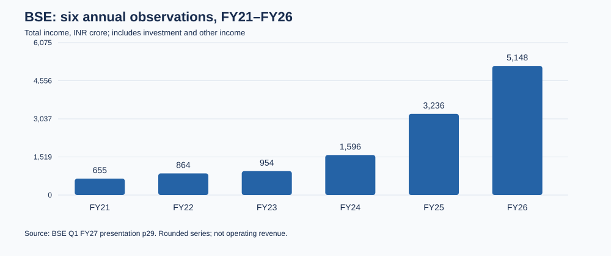

# Peer comparison and historical benchmarks

Cutoff 14 October 2026. INR crore unless specified. VERIFIED means checked against the retrieved document; it does not imply independent verification of the issuer's statements. Source hosting limitations are retained in the appendix.

## Peer selection

**NSE:** direct competitor for equity trading, derivatives liquidity, listings and related infrastructure. Best comparator for competitive economics; size and product mix differ.

**MCX:** comparable fee-based exchange infrastructure, but commodity rather than equity exposure. Useful for operating leverage and technology economics; not a substitute for NSE when analysing market share.

CDSL, CAMS and KFin would add depository/recordkeeping context but are not included in the numeric peer median. Their revenue mechanisms differ. No company is added merely to enlarge the sample.

## Matched annual comparisons

| FY26 consolidated measure | BSE | NSE | MCX | Interpretation |
|---|---:|---:|---:|---|
| Total income incl non-operating income | 5,148.10 | 18,713 rounded | 2,429.05 | Scale differs; total income is not operating revenue |
| Total income growth vs FY25 | 59.1% | -2.4% | 100.9% | Does not isolate fee growth |
| Operating revenue | 4,833.95 | — | 2,302.00 | Do not substitute NSE standalone revenue |
| Operating revenue growth | 63.5% | — | 106.9% | MCX grew faster within this partial comparison |
| Harmonised operating EBITDA margin | 63.7% | — | 71.5% | Excludes non-operating income; retains regulatory/SGF costs |
| Group PAT, total operations | 2,487.25 | 10,302 rounded | 1,331.55 | Includes business-specific exceptional effects |
| Group PAT / total income | 48.3% | 55.1% | 54.8% | Arithmetic ratio, not issuer-defined margin or quality ranking |
| Parent ROE on average equity | 45.0% | — | — | Peer equity reconciliation incomplete |
| Continuing CFO / continuing group PAT | 1.25x | — | — | Clearing balance treatment must be matched |
| Conventional debt/capital restrictions | Cash classification incomplete | Incomplete | Incomplete | Low conventional borrowing alone is insufficient |
| P/E at matching date and EPS basis | 49.1x indicative TTM | — | — | No same-date peer valuation conclusion |

Sources: BSE S1 printed152–155 and S2; MCX P1 PDF13 (company presentation, rounded INR crore); NSE P2 issuer press release reproduced by NoticeBlue, 5 May 2026. Calculations in calculate.py and appendix. The NSE original PDF could not be retrieved; its figures remain UNRESOLVED for direct-host verification. MCX presentation is also mirror-hosted.

**Margin reconciliation:** MCX's reported EBITDA includes other income and uses total income as its denominator. Its 73% headline margin is not directly comparable to BSE's operating margin. Here MCX operating EBITDA = 1,773.63 − 127.05 = 1,646.58; divide by 2,302.00 = 71.5%. BSE operating EBITDA = pre-associate PBT − investment income − other income + depreciation + finance cost = 3,078.69; divide by 4,833.95 = 63.7%. Classification can still differ within operating income; clearing-fund treasury income is retained as classified by each issuer.

## Benchmark table

The peer sample is NSE and MCX, excluding BSE. A median is shown only where both observations exist and definitions can be made explicit. These are two-peer sample medians, **not industry benchmarks**. Percentiles are omitted because this small, heterogeneous sample cannot support a useful sector percentile.

| Metric | BSE | Two-peer median | BSE historical range observed | Percentile | Assessment |
|---|---:|---:|---|---|---|
| FY26 total income | 5,148.1 | 10,571.0 | 654.7–5,148.1, FY21–FY26 | — | BSE is smaller than NSE; size alone says little about return potential |
| Total income growth | 59.1% | 49.3% | 10.5%–102.8%, five annual changes | — | Growth exceeded this arithmetic median; mix effects remain |
| Group PAT / total income | 48.3% | 55.0% | FY25 40.9% to FY26 48.3%, two years only | — | Below both available peers on this definition |
| Operating EBITDA margin | 63.7% | — | FY25 50.7% to FY26 63.7% | — | Improving; below MCX's 71.5%; NSE missing |
| Parent ROE, average equity | 45.0% | — | —, prior average-equity series incomplete | — | Strong observed profitability; trend not established |
| Continuing cash conversion | 1.25x | — | 0.31–1.25x FY25–FY26 | — | Annual improvement; multi-year volatility matters |
| TTM P/E | 49.1x indicative | — | —, point-in-time series unavailable | — | Premium/discount not established |

A justified premium would require stronger sustainable growth, monetisation, cash conversion or lower risk at matched definitions. A justified discount could reflect concentration, governance, weaker durability or capital restrictions. Current information does not demonstrate either mispricing conclusion.

## Six-year performance profile

Company presentation total income, converted from INR million to crore. This includes non-operating income and must not be relabelled sales. All six figures are rounded. S3 PDF29, visually inspected.

| Year | Total income | Annual growth | Interpretation |
|---|---:|---:|---|
| FY21 | 654.7 | — | Starting observation |
| FY22 | 863.5 | 31.9% | Expansion |
| FY23 | 953.9 | 10.5% | Growth moderated |
| FY24 | 1,596.0 | 67.3% | Acceleration; profit comparison affected by disposal gains |
| FY25 | 3,236.3 | 102.8% | Large step-up |
| FY26 | 5,148.1 | 59.1% | Growth continued from a much higher base |

Five-year total-income CAGR: 51.1%, computed across five intervals. This historical rate is not a forecast; adoption, cyclical volumes, changing product economics and non-operating income all contribute.

The presentation's historical profit/EPS panel is labelled continuing/adjusted, but some figures differ from detailed financial statements, including FY25 EPS basis. It is retained as a source, not merged into a falsely uniform six-year reported-EPS series. S1/S2 audited or reviewed statement figures take priority for current calculations. FY24's exceptional gain makes a raw profit-growth comparison particularly misleading.

## Quarterly and capital-allocation context

| Measure | Q1 FY26 | Q4 FY26 | Q1 FY27 | Assessment |
|---|---:|---:|---:|---|
| Operating revenue | 957.95 | 1,563.51 | 1,566.02 | Strong YoY; near-flat sequentially |
| Investment income | 79.06 | 61.69 | 135.18 | Sharp sequential increase; repeatability unresolved |
| Parent PAT | 539.41 | 797.33 | 874.02 | Improving; attribution matters |
| Reported total EPS | 13.09 | 19.35 | 21.22 | Improving, same published post-bonus basis |

S2 PDF5; quarter values are not annualised. FY26 EPS 60.61 includes discontinued operations; trailing EPS uses the matching total-operation basis.

Capital spending rose from INR153.23 crore in FY25 to INR515.16 crore in FY26 (S1 printed154). Cash dividends paid rose from INR205.99 crore to INR315.85 crore. These are cash-flow amounts, not declared-dividend yield. The 2025 bonus changes share units, not enterprise wealth; abeyance allotments require a separate capital reconciliation (S1 printed13–14).

The June2026 ownership presentation combines FPI and NRI holdings. It is a snapshot, not an accumulation signal. A consistent multi-period ownership series has not been retrieved. Historical adjusted share-price returns and P/E ranges remain UNRESOLVED because a verified corporate-action-adjusted price series and point-in-time earnings series are absent. No historical valuation percentile is invented. This six-year income profile is therefore not a complete six-year financial/ownership/market-return panel.
