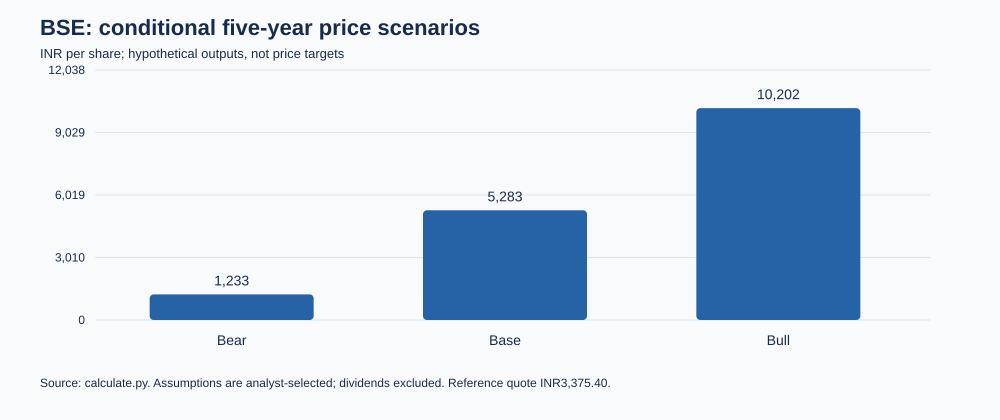

# Growth and valuation scenarios

**SCENARIO ASSUMPTION / CALCULATED.** Baseline: annualised June2026 quarter. Horizons are 1, 3 and 5 years from the research date; results represent terminal annual earnings capacity, not named fiscal-year forecasts. No case probability or probability-weighted expected price is assigned.

| Case | Years | Revenue, crore | EBITDA margin | Parent profit, crore | EPS | P/E | Implied price | Cumulative dividends/share | Wealth incl dividends | Price CAGR | Wealth CAGR |
|---|---:|---:|---:|---:|---:|---:|---:|---:|---:|---:|---:|
| Bear | 1 | 5,967 | 62.3% | 3,047 | 73.22 | 25x | 1,830 | 18.30 | 1,849 | -45.8% | -45.2% |
| Bear | 3 | 5,465 | 57.5% | 2,570 | 60.55 | 25x | 1,514 | 50.11 | 1,564 | -23.5% | -22.6% |
| Bear | 5 | 5,070 | 51.8% | 2,136 | 49.32 | 25x | 1,233 | 76.14 | 1,309 | -18.2% | -17.3% |
| Base | 1 | 7,043 | 67.4% | 3,926 | 95.30 | 35x | 3,336 | 23.83 | 3,359 | -1.2% | -0.5% |
| Base | 3 | 8,908 | 68.5% | 4,930 | 119.68 | 35x | 4,189 | 80.43 | 4,269 | 7.5% | 8.1% |
| Base | 5 | 11,273 | 69.6% | 6,219 | 150.95 | 35x | 5,283 | 151.75 | 5,435 | 9.4% | 10.0% |
| Bull | 1 | 7,574 | 68.7% | 4,278 | 103.84 | 45x | 4,673 | 25.96 | 4,699 | 38.4% | 39.2% |
| Bull | 3 | 11,101 | 71.1% | 6,304 | 153.01 | 45x | 6,886 | 95.70 | 6,981 | 26.8% | 27.4% |
| Bull | 5 | 16,323 | 73.1% | 9,340 | 226.71 | 45x | 10,202 | 198.92 | 10,401 | 24.8% | 25.2% |

Wealth CAGR measures terminal price plus unreinvested cumulative cash dividends relative to the indicative INR3,375.40 starting quote. It is not a dividend-timing IRR. Excludes transaction costs and investor taxes. All prices inherit the unresolved official-price verification.

## Annual assumptions

| Input | Bear | Base | Bull |
|---|---:|---:|---:|
| Industry premium activity | 0.0% | 10.0% | 16.0% |
| BSE relative share change | -5.0% | 3.0% | 5.0% |
| Net fee yield change | -3.0% | 0.0% | 1.0% |
| Other operating revenue growth | 4.0% | 10.0% | 15.0% |
| Fixed cash-cost growth | 8.0% | 8.0% | 10.0% |
| Variable cost / revenue | 20.4% | 17.9% | 17.4% |
| Depreciation growth | 8.0% | 8.0% | 12.0% |
| Investment-income growth | -5.0% | 0.0% | 3.0% |
| Associate profit growth | 0.0% | 5.0% | 10.0% |
| Tax / pre-associate pre-tax profit | 27.0% | 25.0% | 25.0% |
| Cash capex / revenue | 10.0% | 8.0% | 7.0% |
| Working capital / positive revenue increase | 5.0% | 3.0% | 2.0% |
| Additional capital reserve / revenue | 3.0% | 2.0% | 2.0% |
| Annual share dilution | 1.0% | 0.0% | 0.0% |
| Maximum earnings payout | 25.0% | 25.0% | 25.0% |

## Mechanics and limitations

Derivatives revenue compounds industry activity × relative share × net fee yield. A 3% relative share gain means a 1.03 multiplier, not three percentage points of absolute share. Absolute current market share is not verified; the relative index must be checked against industry capacity before use as a forecast. Other operating revenue compounds independently.

Revenue less variable expenses and fixed cash costs gives EBITDA; depreciation is deducted to obtain operating profit. Investment income and other non-operating income are added. Tax is applied before adding the already-after-tax share of associate profit. Non-controlling losses are set to zero for the scenarios. EPS divides parent profit by the assumed diluted share count.

Cash available for the modelled dividend is conservatively proxied as parent profit minus associate profit plus depreciation minus capex, incremental working capital and additional capital reserve. Dividends are the lesser of 25% of positive profit and positive cash proxy. Capital reserve here means additional locked capital, not a second income-statement SGF expense. Cash capex and depreciation are separate.

This is a transparent driver model, not an integrated balance-sheet forecast: it does not allocate assets by useful life, solve regulatory capital requirements, or earn incremental investment income on retained cash. Investment income follows the explicit scenario assumption. The cash proxy cannot establish legal distributability. Terminal P/E reflects all modelled earnings; no additional cash or CDSL valuation is added, avoiding double counting.

The base case is an organising assumption, not management guidance or consensus. Management statements remain in the evidence appendix. No comparable dated analyst forecast set was retrieved. The historical operating-cost split is rounded and the margin outcome is calculated, not independently assumed. Full annual outputs, capital needs and dividends are in calculations.json.
